# SAML 2.0 Single Sign-On with Auth0

  

## Overview

In this lab, I built a real end-to-end **SAML 2.0** integration between an Identity Provider and a Service Provider, established trust through **metadata exchange**, inspected the raw SAML messages, and configured **Single Logout (SLO)**.

| Role | Platform | Purpose |
|---|---|---|
| **Identity Provider (IdP)** | Auth0 | Where users live and authenticate |
| **Service Provider (SP)** | samlsp.com | The application users are trying to log into |
| **Inspection tool** | SAML-tracer (browser extension) | Captures and decodes SAML messages in transit |

## Skills Demonstrated

- SAML 2.0 federation and SP-initiated SSO
- IdP and SP trust configuration
- Metadata exchange (entity IDs, endpoints, X.509 certificates)
- SAML bindings (HTTP-Redirect and HTTP-POST)
- Reading SAML assertions, NameIDs, and attribute statements
- Federated social login (Google brokered through Auth0)
- Single Logout configuration and troubleshooting
- Protecting personal data in authentication evidence

---

## How a SAML Flow Works

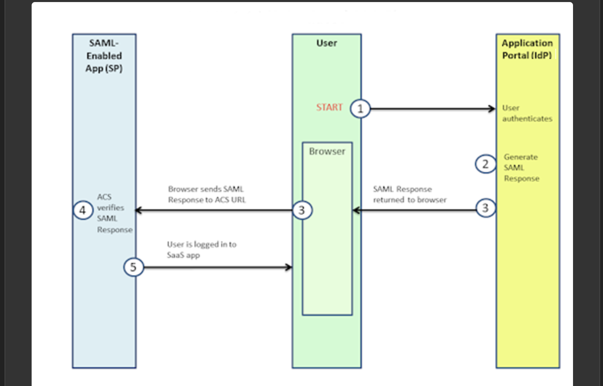

1. The user tries to access the application and is sent to the **Identity Provider** to authenticate.
2. The IdP verifies the user and generates a **signed SAML Response**.
3. The response is returned to the user's **browser**, which posts it to the Service Provider's **Assertion Consumer Service (ACS) URL**.
4. The SP's ACS **verifies the SAML Response** using the IdP's certificate.
5. The user is **logged in** to the application.

The browser carries every message, so the IdP and SP never talk to each other directly. They rely on a pre-established trust relationship instead.

> **To establish this trust, we will configure the SP in Auth0, and then export Auth0's Metadata (an XML file containing certificates and endpoints) to import into the SP.**

---

## Step 1 – Prepare the Service Provider

On samlsp.com, the **"Parameters to configure in your IdP"** section lists the values the Identity Provider needs to know about this application:

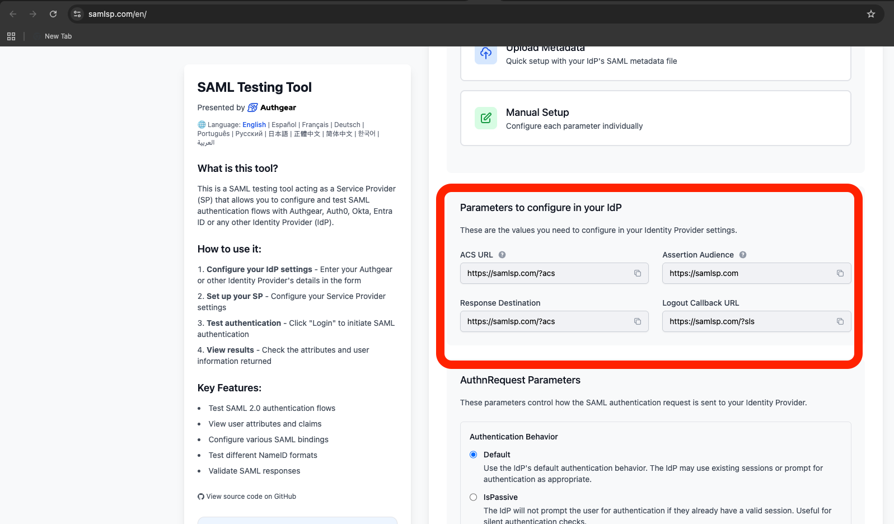

| Parameter | Value | Purpose |
|---|---|---|
| ACS URL | `https://samlsp.com/?acs` | Where the IdP sends the SAML Response |
| Assertion Audience (Entity ID) | `https://samlsp.com` | The unique name of this SP; assertions must be addressed to it |
| Logout Callback URL | `https://samlsp.com/?sls` | Where logout messages return |

---

## Step 2 – Configure Auth0 as the Identity Provider

Created a **Regular Web Application** named **SAML Testing SP**, opened the **Addons** tab, and enabled the **SAML2 Web App** addon:

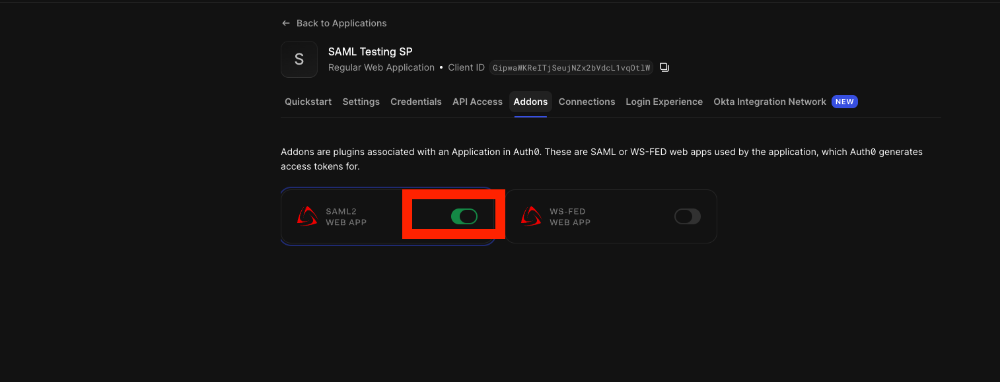

In the addon settings, pasted the SP's ACS URL into **Application Callback URL**. This tells Auth0 exactly where it is allowed to post SAML tokens:

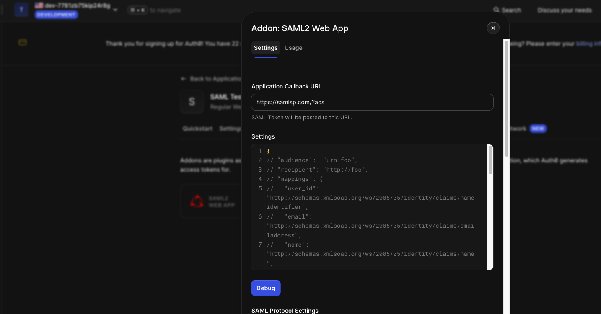

---

## Step 3 – The Metadata Exchange

Auth0's **Usage** tab lists its SAML configuration: issuer, signing certificate, SHA1 fingerprint, and login URL. Downloaded the **Identity Provider Metadata** XML file:

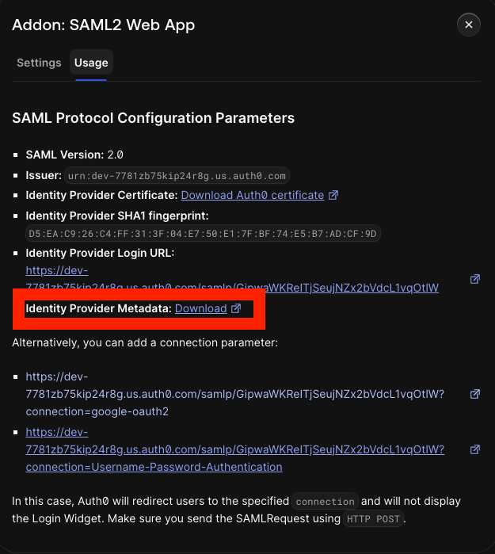

On samlsp.com, uploaded the metadata file. The SP **automatically parsed the XML** and filled in the IdP Entity ID, SSO login URL, Single Logout URL, and X.509 signing certificate:

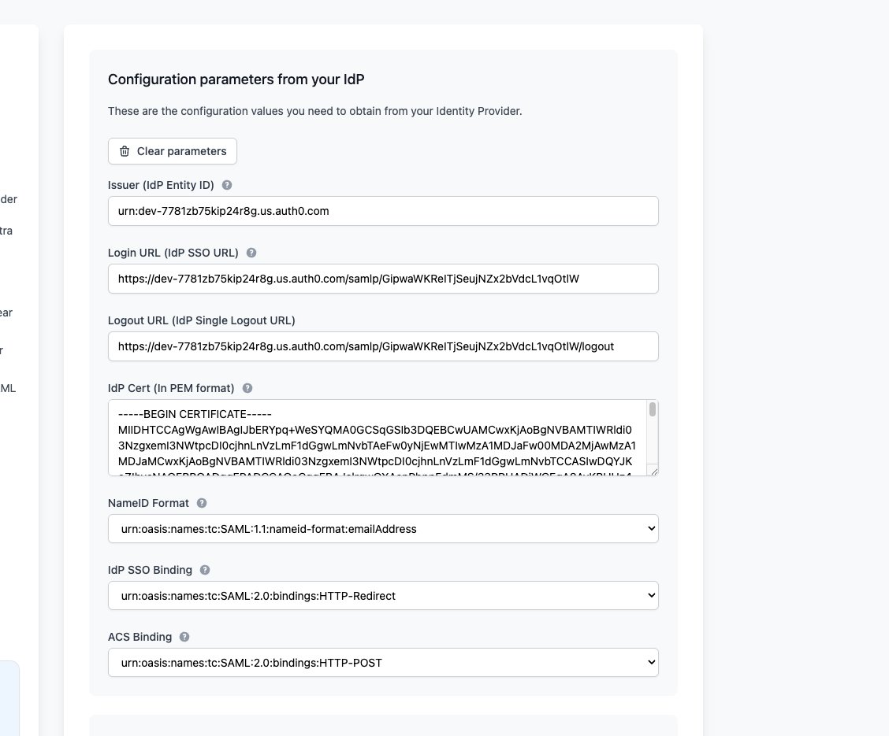

**Why this matters:** this is exactly how enterprise integrations are configured. Instead of copying endpoints and certificates by hand (and risking typos), each side imports the other's metadata. The certificate is what lets the SP verify that assertions really came from Auth0.

The parsed settings also show the **bindings**: the login request goes to the IdP through **HTTP-Redirect**, and the response comes back to the ACS through **HTTP-POST**.

---

## Step 4 – Test SP-Initiated SSO

Started the flow from the Service Provider by clicking **Login**:

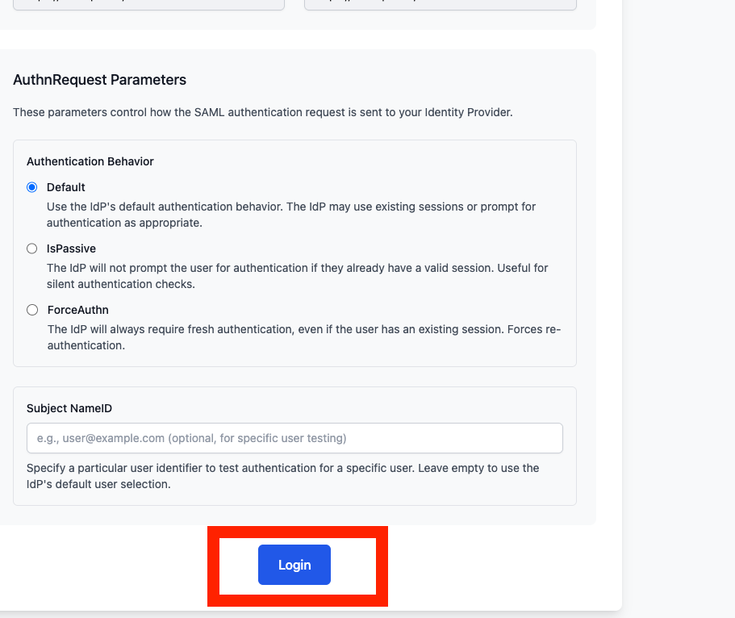

samlsp.com redirected to Auth0, which displayed its login page for **SAML Testing SP**:

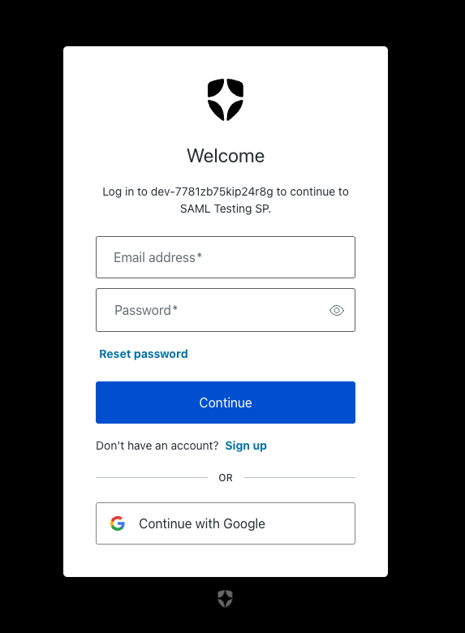

After I authenticated, Auth0 posted a SAML Response back to the ACS URL, and samlsp.com displayed the **parsed identity**: the NameID plus the full set of user attributes.

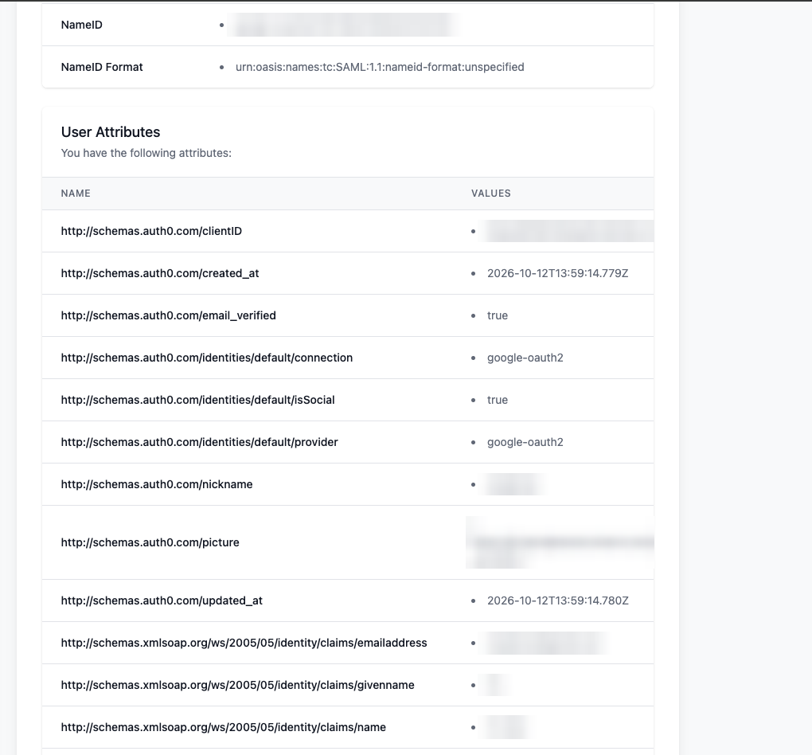

*Personal identifiers (NameID, email, name, nickname, and profile picture) are blurred.*

### What the assertion shows

| Observation | What it means |
|---|---|
| `connection: google-oauth2`, `isSocial: true` | I signed in with Google. Auth0 **brokered** the Google login and translated it into a SAML assertion for the SP, so the app never talked to Google directly |
| `email_verified: true` | The IdP vouches that the email address is verified |
| Attributes use `schemas.xmlsoap.org/.../claims/` names | Standard claim URIs the SP uses to map identity data |
| NameID Format `unspecified` | The SP was configured to expect `emailAddress`, but Auth0 sent its internal user ID by default. In a real integration, this would be aligned through Auth0's `nameIdentifierFormat` and mappings settings so the app receives the identifier it expects |

In SAML-tracer, the first two requests are the HTTP-Redirect **GET**s to Auth0 carrying the `SAMLRequest`, followed by the HTTP-POST to `https://samlsp.com/?acs` carrying the SAML Response. That matches the bindings from Step 3.

---

## Step 5 – Single Logout (SLO)

### First attempt: logout not yet configured

Clicking **Logout** before configuring SLO returned an error from Auth0:

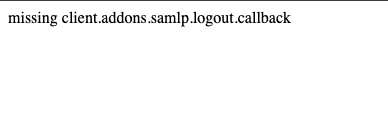

The message `missing client.addons.samlp.logout.callback` means Auth0 received the logout request but had no configured destination to send the user back to.

### Configuration

Added the logout block to the SAML2 addon settings:

```json
{
  "logout": {
    "callback": "https://samlsp.com/",
    "slo_enabled": true
  }
}
```

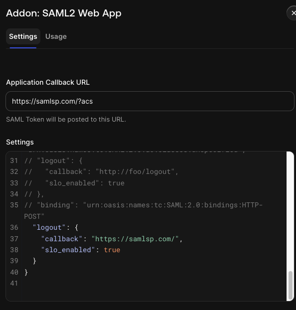

Then added `https://samlsp.com/` to the application's **Allowed Logout URLs**, since Auth0 only redirects to approved destinations:

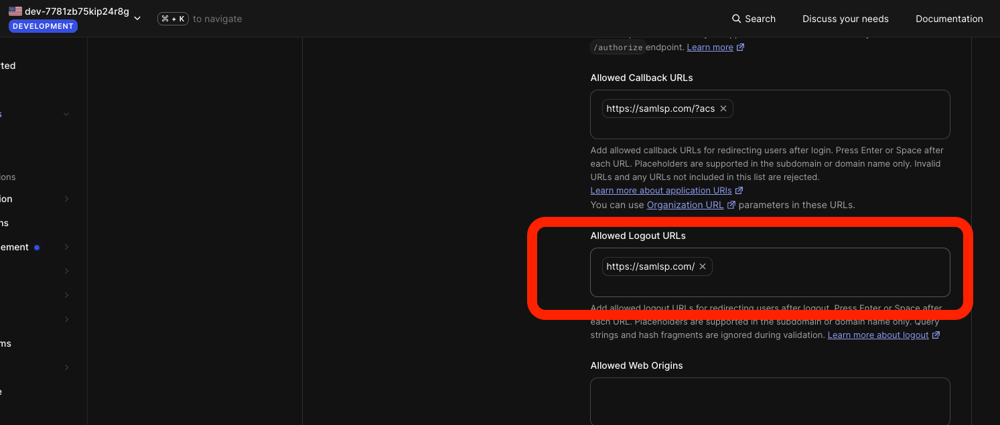

### Watching the logout flow in SAML-tracer

The SP sent a **`LogoutRequest`** to Auth0's logout endpoint, identifying the user (NameID) and the session (SessionIndex) to terminate:

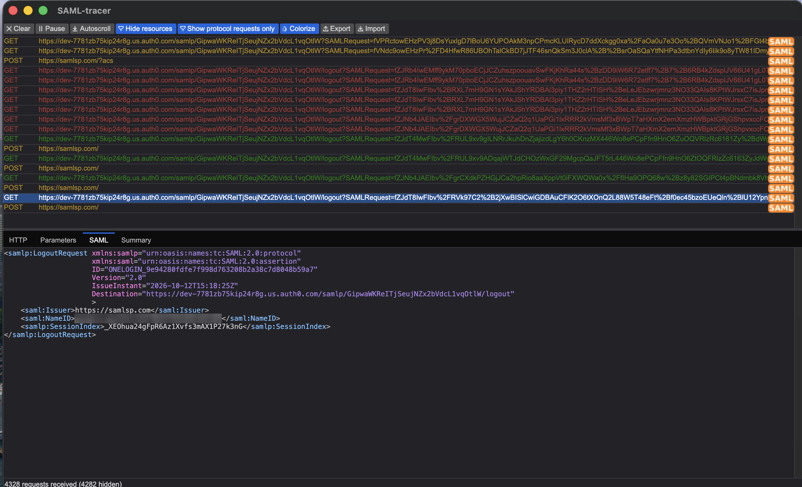

Auth0 replied with a **`LogoutResponse`** posted back to the SP. Two details matter:

- **`InResponseTo`** matches the request's ID (`ONELOGIN_9e94280f...`), which is how the SP pairs the response with the request it sent.
- The response is **digitally signed** (RSA-SHA256) by Auth0, so the SP can verify it is genuine.

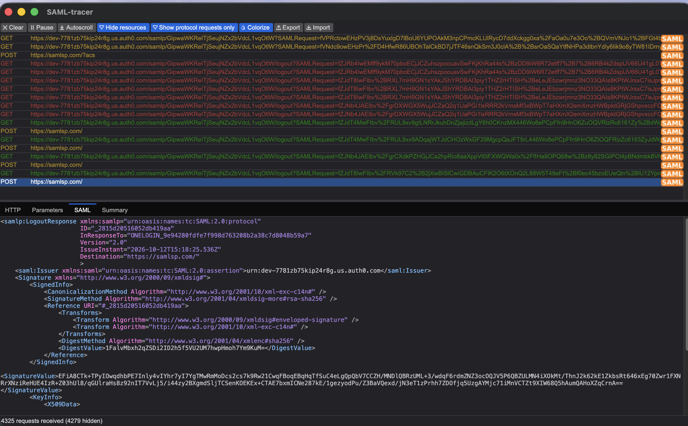

### Why logout doesn't fully complete

The logout flow fires and redirects correctly, but the sample SP's own logout callback returns an internal server error on its side, so the session does not fully clear. This is a limitation of the test site, not the configuration, and it can't be fixed without control of that site. To re-test from a clean state, use a new private window each time.

This mirrors real-world projects: **SSO almost always works because everyone tests it, but single logout frequently breaks**, because it depends on both the IdP and the SP implementing the callback correctly. One weak link breaks the chain.

---

## Key Takeaways

1. **SAML trust is built on metadata.** Exchanging metadata gives each side the other's endpoints and signing certificate.
2. **The browser is the messenger.** The IdP and SP never connect directly, so signatures are what make the messages trustworthy.
3. **Bindings matter.** Requests travel through HTTP-Redirect, and responses through HTTP-POST to the ACS URL.
4. **Attributes drive authorization.** The SP relies on the claims in the assertion, so mapping the right NameID and attributes is part of every integration.
5. **Federation can be layered.** Auth0 brokered a Google login and presented it to the app as SAML.
6. **SSO is easy; single logout is where federation breaks.**

## References

- [OASIS SAML 2.0 Technical Overview](https://docs.oasis-open.org/security/saml/Post2.0/sstc-saml-tech-overview-2.0.html)
- [Auth0: SAML Configuration](https://auth0.com/docs/authenticate/protocols/saml)
- [samlsp.com SAML Testing Tool](https://samlsp.com/)
- [SAML-tracer](https://addons.mozilla.org/firefox/addon/saml-tracer/)
